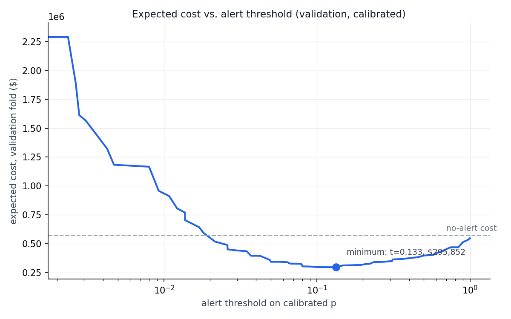

# Card fraud detection on IEEE-CIS, measured in dollars

<!-- Add a sentence or two here about why you built this, in your own words. -->

This project builds a fraud screening policy for card transactions and evaluates it by total dollar cost instead of accuracy or AUC. It uses the IEEE-CIS Fraud Detection dataset from Kaggle[^1], PostgreSQL for data prep and feature engineering, a rules-based baseline, and a calibrated LightGBM model.

> [!NOTE]
> Every number in this README is printed by `make run`. See [How to run it](#how-to-run-it).

## Contents

- [Results](#results)
- [Cost assumptions](#cost-assumptions)
- [Findings](#findings)
- [Limitations](#limitations)
- [Next steps](#next-steps)
- [How to run it](#how-to-run-it)
- [Project structure](#project-structure)

## Results

The test set is the last ~15% of the timeline (88,581 transactions). It wasn't used for training or for choosing thresholds.

| Policy | Test cost | Change vs. no alerts |
|---|---|---|
| No alerts | $546,684 | |
| Rules baseline | $445,281 | -18.5% |
| LightGBM, calibrated | $283,703 | -48.1% |

Both the rules baseline and the model use the same expected-value decision rule, explained [below](#using-a-dollar-threshold-instead-of-a-probability-cutoff). The model's cost is $161,578 lower than the rules baseline, about 36%.

At its operating point the model raised 4,966 alerts over the 31-day test window, roughly 160 a day. Precision was 0.317 and recall was 0.511, and the flagged transactions made up 67.8% of fraud dollars.

I also looked at what happens with a fixed review capacity. Ranking transactions by expected loss (probability × amount), 100 alerts a day covers 59.1% of fraud dollars in the test set, and 500 a day covers 88.1%.



## Cost assumptions

Each transaction gets a cost based on what happens to it:

| Outcome | Cost |
|---|---|
| Legitimate, not flagged | $0 |
| Fraud, flagged | $2 for a manual review |
| Legitimate, flagged | $27 ($2 review plus $25 for the declined customer) |
| Fraud, not flagged | Transaction amount plus a $25 dispute fee |

> [!IMPORTANT]
> The $25 customer friction cost is an estimate, and the results are sensitive to it. Changing it to $10 or $50 moves the model's test cost to $211,367 or $339,911. See [Limitations](#limitations).

## Findings

### Using a dollar threshold instead of a probability cutoff

The usual approach is to pick a probability cutoff and flag everything above it. With the costs above, the cheapest decision for a single transaction is to flag it when

```
p × (amount + 25) > 2 + (1 − p) × 25
```

which simplifies to `amount > 27/p − 50`. So the rule is a dollar threshold that depends on the predicted probability. A transaction with a low fraud probability can still be worth reviewing if the amount is high enough.

This matters on this dataset because fraud isn't concentrated in large purchases. The 99th percentile fraud amount is $994, which is lower than the 99th percentile for legitimate transactions ($1,104). A probability cutoff can't reach low-probability, high-amount transactions, and that's where a lot of the loss is. For the rules baseline, switching from a swept probability cutoff to the expected-value rule lowered test cost by $52,895.

Since the rules score only has four levels, the baseline policy comes down to four dollar thresholds (`make baseline`):

| Rules fired | Train fraud rate | Alert when amount exceeds |
|---|---|---|
| 0 | 0.034 | $748 |
| 1 | 0.065 | $365 |
| 2 | 0.133 | $152 |
| 3+ | 0.133 (pooled) | $152 |

The rules pick which threshold applies, and the amount decides the rest.

The first time I fit the score-to-probability mapping, a cell with only 4 rows got p = 0, which meant it would never alert. A 45-row cell also gave a higher score a higher dollar threshold. I fixed both by merging small cells and applying pool-adjacent-violators so the mapping is monotone.

### Rebuilding the card ID

The dataset doesn't include a card ID, so one has to be reconstructed for the velocity features. My first version combined `card1` to `card6`, `addr1`, and `P_emaildomain`. That gave 94,873 keys, but the distribution was bimodal (`make profile`). The median key had 2 transactions, while the largest had 4,002 transactions across all 182 days, with a fraud rate close to the overall average. That key was clearly many cards grouped together. The 100 largest keys held 13.3% of all transactions.

Most of the problem came from missing addresses. `addr1` is null in 11.1% of rows, and the nulls let different cards share a key. Keys with a null `addr1` had 22.0% of their transactions in keys with 1,000+ transactions, compared with 3.1% for keys with an address. Common BIN combinations caused some pooling too.

The fix was to add `day − D1` to the key.[^2] Within small keys, `day − D1` was either exactly constant (12,756 of 27,232 keys) or spread over months (11,226 keys). Only 173 keys had a range of exactly one day, which is what rounding would look like if it were splitting real cards. That pattern fits a value that stays fixed for each card and gets mixed when cards are pooled together.

The new key produces 278,270 entities. The 4,002-transaction key splits into 362 pieces with normal card-sized counts, and the top 100 keys drop from 13.3% to 1.5% of transactions.

The downside is that more transactions now have no earlier history on their key, so velocity features are undefined for them: 47.1% of rows, up from 16.1%. I decided that was better than computing velocity over keys I knew were pooled.

### Automated traffic with no fraud

Eleven keys with at least 100 transactions each have 3,107 transactions combined and no fraud. At the base rate you'd expect about 109. These look automated. One key has 1,414 transactions over 52 days with a median gap of 12 seconds (ProductCD S, full identity coverage). The others look like recurring billing, with fixed amounts on a roughly daily schedule (ProductCD W). Seven of the eleven are still active in the test period.

The rules baseline treats this traffic like a fraud burst. With a probability cutoff, it flags 1,354 of these transactions in the test set, which is $36,558 in false positives and 31% of its alerts. The model doesn't flag any of them at any operating point. That isn't only because of the dollar threshold. The model's average calibrated probability on these 3,107 transactions is 0.0024, compared with 0.0403 across all transactions.

### The SQL features did not improve the model

I built six velocity features in Postgres. To check whether they helped, I retrained the model without them. Test cost went down by $1,653 at seed 42 and by $750 at seed 43, so the model did slightly better without them. On its own, the model's cost varies by $4,891 between seeds, so the difference is within noise.

An earlier single-seed run showed the features saving $8,306. That was before I had measured the variation between seeds, and it's why the ablation now runs on two seeds.

The most likely reason is that the dataset already includes the vendor's count features (C1-C14) and timedeltas (D1-D15), which were computed using the real card identity. My features approximate the same information with a reconstructed key. `c14` and `d2` are both in the model's top 10 features by gain.

The Postgres layer is still used for the rules baseline, the dollar thresholds, the train/test split and leakage checks, and the card key analysis above. It just doesn't add predictive value to the model.

## Limitations

- **Calibration.** The raw LightGBM probabilities were too low by 1.8 to 12.1 times across validation deciles, even after correcting for `scale_pos_weight`. The error was worst on easy negatives, which points to boosting overconfidence rather than a bug in the correction. Isotonic regression fit on the validation set fixed the deciles and lowered test cost by $22,505. Calibration is required here because the decision rule uses the probability values directly. A swept probability cutoff only changed by $392, since it depends on ranking alone.
- **Customer friction cost.** Setting it to $10, $25, or $50 gives a test cost of $211,367, $283,703, or $339,911. That's a range of about $129K from one assumption, and alert volume roughly halves or doubles with it.
- **Drift.** The operating point and calibration are fit on the validation month and applied to the next month. At 100 alerts a day, fraud dollar coverage drops from 65.2% on validation to 59.1% on test.
- **Seed noise.** Results vary by about $5K between seeds. They also depended on row order until I added `ORDER BY transactionid`. Differences smaller than that are treated as noise.
- **Anonymized features.** The top features by gain are `v258`, `v294`, and `c14`, and it's not known what they measure. The model is specific to this dataset.
- **Remaining key issues.** The refined key still has one entity with 1,414 transactions. 0.21% of rows have no D1 and fall back to the coarser key, and transactions in the same second make trailing windows slightly off for 0.02% of rows.

## Next steps

<!-- These are suggestions based on the limitations. Edit or replace them with your own plans. -->

- [ ] Replace the $25 friction estimate with a number based on real data, or report results across a range
- [ ] Recalibrate monthly and measure how quickly performance drifts
- [ ] Test whether the velocity features help when the vendor's C and D columns are removed

## How to run it

You need Docker, plus `train_transaction.csv` and `train_identity.csv` from Kaggle[^1] placed in `data/raw/`.

```bash
docker compose up -d
make setup   # virtualenv, dependencies, and Postgres 16
make run     # load, migrate, profile, baseline, model
```

`make run` prints every number in this README and saves the cost curve to [`results/cost_curve.png`](results/cost_curve.png). You can also run `make profile` or `make baseline` on their own. See the [`Makefile`](Makefile) and [`docker-compose.yml`](docker-compose.yml) for details.

After a full teardown (`docker compose down -v`) and rebuild, the profile output matched byte for byte.

## Project structure

| Path | Contents |
|---|---|
| [`sql/`](sql/) | Numbered migrations: type casting, entity keys, features, train/test split |
| [`src/`](src/) | `load.py`, `migrate.py`, `profile.py`, `baseline.py`, `model.py`, `evaluate.py` |
| [`results/`](results/) | Cost curve plot |
| `data/raw/` | Kaggle CSVs (not committed) |

Stack: Python 3.11, PostgreSQL 16 in Docker, psycopg2 and SQLAlchemy, pandas, LightGBM, scikit-learn, matplotlib.

[^1]: [IEEE-CIS Fraud Detection](https://www.kaggle.com/c/ieee-fraud-detection/data) on Kaggle. You need a Kaggle account and have to accept the competition rules to download the data.

[^2]: The competition only describes D1-D15 as timedeltas, without saying exactly what each one measures. I only rely on the property I measured here, that `day − D1` stays constant within a card. I'm not claiming to know what D1 represents.
